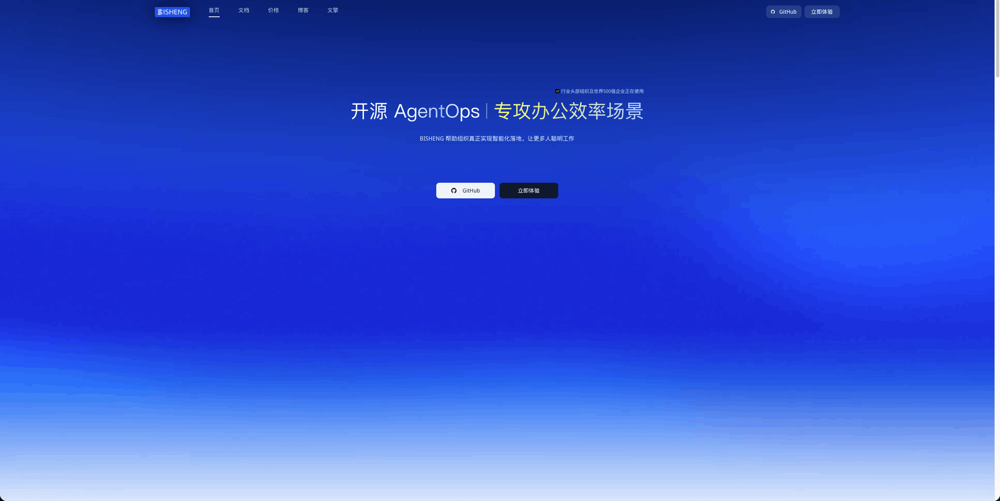

> 历史快照：保留原教程或验收方案，不代表 MinerU 4.1 的当前支持范围；请从 [现行文档](../../zh/index.md) 开始。

# BISHENG 简介

> 适用范围：本页保留对应平台或插件的使用教程。云服务、社区插件和本地 MinerU 4.1 的接口不能互换；本地版本兼容性以 [集成说明](../../zh/usage/integrations.md) 和实际插件版本为准。

BISHENG毕昇 是一款开源 LLM应用开发平台，主攻企业场景， 已有大量行业头部组织及世界500强企业在使用。“毕昇”是活字印刷术的发明人，活字印刷术为人类知识的传递起到了巨大的推动作用。BISHENG毕昇团队希望“BISHENG毕昇”同样能够为智能应用的广泛落地提供有力支撑。

- 官网地址：https://bisheng.dataelem.com/
- Miner 在BISHENG毕昇 项目中的插件项目：https://github.com/dataelement/bisheng/pulls

特别鸣谢 [@pzc163](https://github.com/pzc163)
