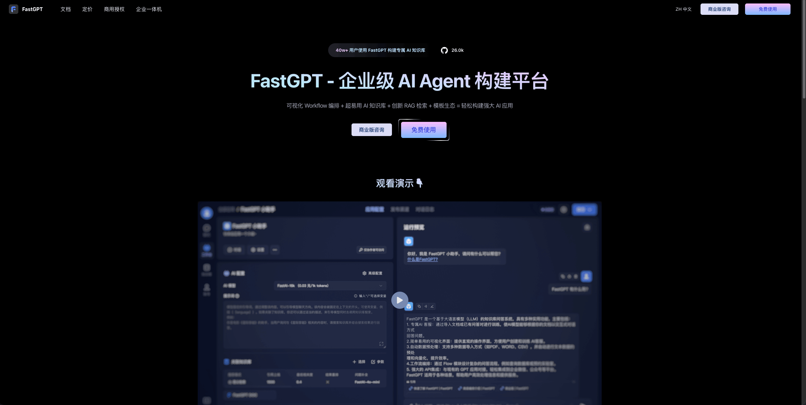
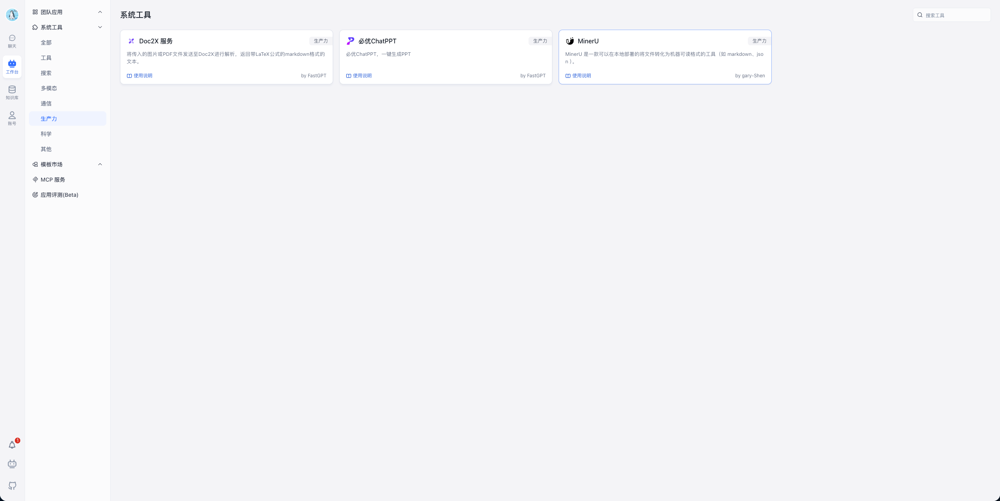

> 历史快照：保留原教程或验收方案，不代表 MinerU 4.1 的当前支持范围；请从 [现行文档](../../zh/index.md) 开始。

# FastGPT  简介

> 适用范围：本页保留对应平台或插件的使用教程。云服务、社区插件和本地 MinerU 4.1 的接口不能互换；本地版本兼容性以 [集成说明](../../zh/usage/integrations.md) 和实际插件版本为准。

FastGPT 是一个基于 LLM 大语言模型的知识库问答系统，将智能对话与可视化编排完美结合，让 AI 应用开发变得简单自然。无论您是开发者还是业务人员，都能轻松打造专属的 AI 应用。

目前，MinerU 插件已在 Coze 插件商店上线，通过其强大的文档解析能力，为用户搭建智能体与工作流提供文档解析能力，加快用户 AI 应用的开发。

- 官网地址：https://fastgpt.cn
- Miner fastGPT 插件下载地址：https://cloud.fastgpt.io/dashboard/systemPlugin?type=productivity
