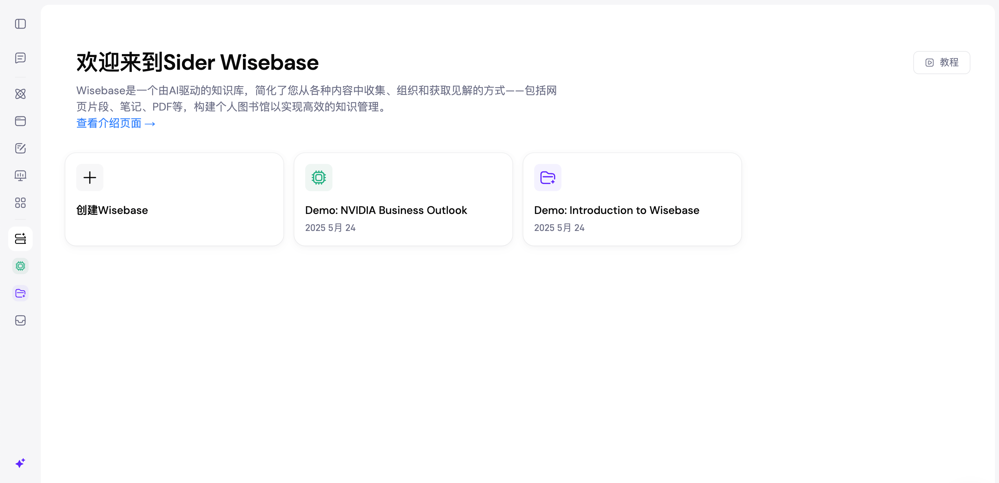

> 历史快照：保留原教程或验收方案，不代表 MinerU 4.1 的当前支持范围；请从 [现行文档](../../zh/index.md) 开始。

# Sider 简介

> 适用范围：本页保留对应平台或插件的使用教程。云服务、社区插件和本地 MinerU 4.1 的接口不能互换；本地版本兼容性以 [集成说明](../../zh/usage/integrations.md) 和实际插件版本为准。

Sider 是一款浏览器侧边栏类的 AI 助手扩展，主要在网页右侧开启一个“随处可用”的智能面板，将对话式 AI（如 GPT、Claude、Gemini 等）带到你正在浏览的任何页面中。它的核心定位是：提升阅读、写作、翻译、检索与总结效率，并与网页内容深度联动。

目前，Sider在 Wisebase 模块中深度集成了 MinerU 的相关功能。该模块是一个由AI驱动的知识库，您可以通过上传 PDF 等各类型文件，构建个人图书馆以实现高效的知识管理，MinerU 可以帮助您更好地解析此类文件，精准地提取文件中的信息。

- Sider 官网地址：https://sider.ai/zh-CN/chat
- 使用集成 MinerU 相关功能的 Sider 地址：https://sider.ai/zh-CN/wisebase
